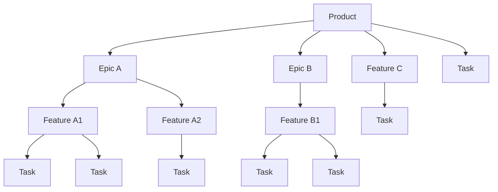

# Taskman

**Project and task management for teams building software with coding agents.**

Taskman connects requirements, project plans, tasks, and validation. It includes a Python command-line tool and development skills for Claude Code; Codex integration is the next step.

The command-line tool is `taskman`, with `tm` as a short alias. Both run the same commands. Claude Code skills use the `/tm:` prefix.

 
## Quick start

One command installs everything — the `taskman` CLI and the `tm` plugin:

```
curl -fsSL https://raw.githubusercontent.com/AgentureHQ/taskman/main/install.sh | sh
```

It installs `uv` (which fetches Python 3.11+ if you don't have it), installs `taskman`, then registers the `tm` plugin with Claude Code. Requires the [Claude Code CLI](https://claude.com/claude-code) to be installed already. Re-run it any time to upgrade.

Open a **new terminal** so `taskman` is on `PATH`, start `claude`, and the `/tm:*` skills are available. Verify with `taskman version`.

### Manual install

Prefer to run the steps yourself? Two parts — the plugin, then its `taskman` CLI.

**1. Plugin** — add the marketplace once, then install:

```
/plugin marketplace add AgentureHQ/taskman
/plugin install tm@taskman
```

Restart Claude Code (or run `/reload-plugins`) and the `/tm:*` skills become available.

**2. `taskman` CLI** — the `/tm:*` skills drive a task CLI named `taskman`, a standalone Python app. Install it straight from GitHub (`uv` fetches Python 3.11+ if you don't have it):

```
uv tool install "git+https://github.com/AgentureHQ/taskman.git#subdirectory=taskman"
```

Verify with `taskman version`. If your shell can't find `taskman` afterward, run `uv tool update-shell` and restart the shell so uv's tool directory is on `PATH`. (`pipx`/`pip` work too, given Python ≥3.11.) **If a skill reports `taskman: command not found`, this step was missed — run it, or re-run the one-line installer above.**

> **Status — skill integration in progress.** Wiring `/tm:*` to this CLI is an active epic (`taskman_skill_integration`). Until it lands, the commands below are not yet fully functional on a fresh marketplace install — today they run only inside a clone of this repo, which still uses the legacy bundled `taskman.sh`.

Then walk the lifecycle for whatever you're building. The smallest useful loop — a single change or bug:

```
/tm:define task              # write the requirements (WHAT/WHY)
/tm:implement task <path>    # detailed design → code → tests
/tm:validate task            # run the task's quality gates
```

## The workflow

`tm` automates the **software development lifecycle**, not a ticket tracker. Work moves through the phases a disciplined engineering team uses, with a review gate between each:

```
define → design → plan → implement → validate   (+ maintenance, anytime)
```

The contract is the same at every phase: **you define WHAT and WHY, the agent derives HOW, and a review gate stands between phases.** Specs and plans hold requirements and acceptance criteria — never implementation code. The agent generates implementation from the spec, not from a ticket title or chat history.

Each phase has a skill. Most take a `<level>` so you run the same phase at any granularity.

### 1. Define — *what & why*
`/tm:define <level>` where `<level>` ∈ `product | epic | feature | task`
- **product** → vision / spec / requirements in `docs/`
- **epic** → an epic file + its linked feature files
- **feature** → a feature file + its linked task files
- **task** → a single task or bug ticket in `tasks/backlog/`

Produces requirements (WHAT/WHY) — never implementation detail.

### 2. Design — *architecture*
`/tm:design <level>` where `<level>` ∈ `product | epic | feature`
- **product** drafts `docs/architecture.md` in-session
- **epic / feature** refine that unit's design in place

### 3. Plan — *decomposition*
`/tm:plan <level>` — revises how a unit breaks down: an epic into features, or a feature into tasks. Plan-only; writes no code.

### 4. Implement — *code & tests*
`/tm:implement <level> <id>`
- **task** (takes a file path) → detailed design → code → tests; halts on an upstream design gap
- **feature** (takes a slug) → runs every open task in order
- **epic** (takes a slug) → runs every linked feature in order

### 5. Validate — *quality gates*
`/tm:validate <level>` where `<level>` ∈ `task | feature | epic | product` — runs the gates for that tier before it can close. Task-level gates run in the main session; feature / epic / product QA runs in a fresh context via the QA sub-agent.

### Maintenance — *anytime*
- `/tm:code-review` — read-only audit, emits backlog tasks
- `/tm:code-commit` — staged, well-formed commit
- `/tm:code-comment` — add explanatory comments
- `/tm:docs-sync` — reconcile upstream docs after a unit closes

### State is managed by `taskman.sh`
Skills compose content in dialog with you, then hand off to `./scripts/taskman.sh` as the save step. Files move `backlog → active → done`; a feature can't close until all its tasks are `done`, an epic until all its features are `done`.

## Common paths

Match the entry point to where you are. Pick the smallest one that fits the scope.

**Greenfield product** — start at Define and walk the full cycle.
```
/tm:define product           # vision + spec + requirements → docs/
/tm:design product           # architecture → docs/architecture.md
/tm:define epic              # design + plan for an epic (Planner sub-agent)
/tm:implement epic <slug>    # iterate features, stop per task for review
/tm:validate product         # full-system QA via the QA sub-agent
```

**Incremental feature** — docs already exist; enter at Define.
```
/tm:define feature           # design + plan for the new feature
/tm:plan feature             # revise the task breakdown (optional)
/tm:implement feature <slug> # each task in order
/tm:validate feature         # integration tests via the QA sub-agent
/tm:docs-sync                # reconcile docs after close
```

**Single change or bug** — smallest work item.
```
/tm:define task              # task or bug — requirements only
/tm:implement task <path>    # detailed design → code → tests; halts on upstream design gap
/tm:validate task            # task-level quality gates (main session)
```

**Optimization** — surface debt, then schedule it.
```
/tm:code-review              # read-only audit → backlog tasks
/tm:define feature           # group the findings worth doing
/tm:implement feature <slug>
/tm:validate feature
```

See [plugins/tm/README.md](plugins/tm/README.md) for the full skill reference and the `taskman.sh` lifecycle CLI, and [docs/specification.md](docs/specification.md) for the normative methodology and plugin specification.

## Work units: product, epic, feature, task

The lifecycle above runs at four granularities. Pick the smallest one that fits the scope — the phases are the structure; sizing is a convenience.

| Size | Use when | File |
|------|----------|------|
| **Product** | The whole system — vision, spec, architecture | `docs/` |
| **Epic** | A functional block spanning multiple features | `tasks/epics/` |
| **Feature** | One coherent unit of work, usually one branch | `tasks/features/` |
| **Task** | A single implementation step or bug fix | `tasks/backlog/` → `active/` → `done/` |

A product holds many epics, an epic many features, a feature many tasks — but the hierarchy is open, not fixed: every level is optional one up. A feature can have no parent epic; a task can be ad-hoc with no parent feature or epic.



**Feature C** has no parent epic, and the top-level **Task** is ad-hoc.

## Available plugins

| Plugin | What it does | Docs |
|--------|--------------|------|
| `tm` | Agentic SDLC loop — define, design, plan, implement, and validate through structured `/tm:*` skills with built-in review gates | [plugins/tm/README.md](plugins/tm/README.md) |

## Repository layout

```
taskman/
├── .claude-plugin/
│   └── marketplace.json          # marketplace manifest
├── plugins/
│   └── tm/                       # the agentic-SDLC plugin
│       ├── .claude-plugin/plugin.json
│       ├── skills/
│       ├── rules/
│       ├── scripts/
│       └── README.md
├── docs/                         # product docs for the marketplace
├── tasks/                        # this repo's own SDLC tracking (dogfoods tm)
├── LICENSE
├── PRIVACY.md
└── README.md
```

## Adding a new plugin to the marketplace

1. Create `plugins/<your-plugin>/` with its own `.claude-plugin/plugin.json` and any of `skills/`, `agents/`, `commands/`, `hooks/`, `.mcp.json`. All paths must be self-contained inside the plugin directory.
2. Add a new entry to the `plugins` array in `.claude-plugin/marketplace.json`.
3. Update the **Available plugins** table above.

See [Claude Code's plugin marketplace docs](https://code.claude.com/docs/en/plugin-marketplaces.md) for the full schema.

## Developing and testing plugins locally

This section is for contributors who develop the marketplace itself. End users should follow [Quick start](#quick-start) above.

### Test an unpublished change from another project

Local changes are not on GitHub yet, so install the marketplace from your local checkout instead of the GitHub shorthand. Use the **absolute path** — a relative `./` only resolves when Claude Code runs inside this repo.

```
/plugin marketplace add /absolute/path/to/taskman
/plugin install tm@taskman
```

Then run `/reload-plugins` (or restart Claude Code) so the `/tm:*` skills load.

### Refresh after editing the plugin

A locally added marketplace is cached. After changing `marketplace.json`, a `plugin.json`, or any skill, refresh the cache:

```
/plugin marketplace update taskman     # re-read this marketplace
/reload-plugins                          # reload skills into the session
```

If an entry is broken or stale (for example, a failed earlier `add`), remove and re-add it:

```
/plugin marketplace remove taskman
/plugin marketplace add /absolute/path/to/taskman
```

### Dogfooding inside this repo

When you run Claude Code **inside this repo**, the `tm` skills load automatically without `/plugin install` — `.claude/` symlinks point at the plugin sources:

```
.claude/skills -> plugins/tm/skills
.claude/rules  -> plugins/tm/rules
```

### Publish

A local install pins the marketplace to your machine's path and resolves only for you. For the [Quick start](#quick-start) command (`AgentureHQ/taskman`) to work for everyone, push your commits to `origin/main` so GitHub serves the updated `.claude-plugin/marketplace.json`.

## License

[Apache 2.0](LICENSE). See [PRIVACY.md](PRIVACY.md) for the privacy policy.
